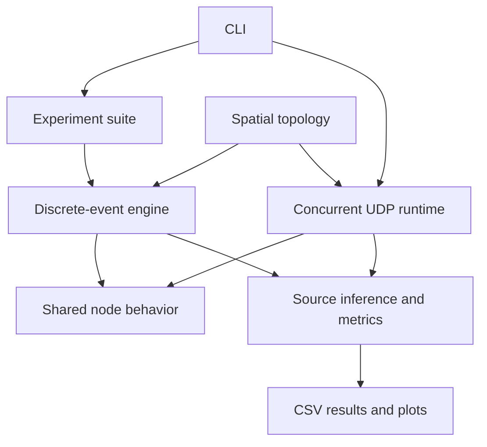

<div align="center">

# Dandelion Spy Simulator

### Message propagation and source privacy in peer-to-peer networks

A Python simulator for comparing **diffusion**, **Dandelion**, and **source-inference attacks** across clustered networks.


[Get started](#getting-started) · [Results](#results-at-a-glance) · [Experiments](#running-experiments) · [Architecture](#architecture) · [Read the report](Report.pdf)

</div>

## Overview

How much can a network hide a message's source without sacrificing delivery? This project explores that question using a clustered spatial network, two propagation protocols, and an adversary observing traffic through selected spy nodes.

**Diffusion** broadcasts messages across the network immediately. **Dandelion** first follows a narrow Stem path, then switches to a broadcast Fluff phase. The simulator measures how this choice affects source-estimation accuracy, propagation time, and delivery coverage.

The implementation includes:

- A **discrete-event engine** for seeded experiments and parameter sweeps.
- A **concurrent UDP runtime** with one localhost port per node.
- **Source-inference attacks**, including first-spy, timing-based, and Monte Carlo calibrated methods.
- **Five experiment phases**, CSV exports, plots, and a Persian report.


## Getting started

**Requirements:** Python 3.10+, NumPy, and Matplotlib. Graph algorithms and networking use the Python standard library.

```bash
git clone https://github.com/sepehrghias/dandelion-spy-simulator.git
cd dandelion-spy-simulator

python3 -m venv .venv
source .venv/bin/activate
python -m pip install -r Code/requirements.txt

# Generate and validate a network topology.
python Code/main.py topology --seed 1

# Send 30 packets through a real localhost UDP network.
python Code/main.py demo --seed 1 --p 0.5 --packets 30
```

On Windows, use `python -m venv .venv` and activate with `.venv\Scripts\Activate.ps1` in PowerShell.

The demo uses controller port **20999** and node ports starting at **21000**, all on `127.0.0.1`. Run one UDP scenario at a time with these ports available.

## Results at a glance

The recorded experiments show a clear tradeoff: a higher Stem continuation probability reduces the adversary's source-estimation accuracy, while fewer packets reach the coverage threshold.

| Stem probability | Mean T80 | Reach rate | First-spy accuracy | Calibrated attack accuracy |
| :---: | ---: | ---: | ---: | ---: |
| `p = 0.9` | 1.818 s | 28% | 21.7% | 26.3% |
| `p = 0.5` | 1.666 s | 81% | 23.0% | 37.4% |
| `p = 0.1` | 1.533 s | 95% | 22.9% | 47.4% |

These rounded values come from the Phase 3 and Phase 4 summaries in the supplied [experiment log](logs/full_run.log), rather than a new benchmark. The original raw CSV files are absent; regenerate them using the full experiment command below.

**Interpret T80 alongside reach rate:** mean T80 includes only packets that reach 80% of nodes. Undelivered packets are excluded from this time metric.


<details>
<summary><strong>View the remaining experiment plots</strong></summary>


</details>

## Running experiments

| Phase | Experiment |
| :---: | --- |
| **1** | Baseline diffusion and network coverage |
| **2** | Source inference against diffusion; spy-count sweep |
| **3** | Dandelion propagation for `p ∈ {0.9, 0.5, 0.1}` |
| **4** | First-spy versus calibrated source inference against Dandelion |
| **5** | Intentional spy forwarding delays and their effect on privacy and propagation |

Run these commands from the repository root:

```bash
# Full suite: five seeds, 200 packets per scenario.
python Code/main.py all

# Quick exploratory suite: two seeds, 60 packets per scenario.
python Code/main.py all --quick

# Run a single phase with explicit seeds.
python Code/main.py phase 3 --seeds 1 2 3

# Demonstrate diffusion through UDP.
python Code/main.py demo --phase diffusion --packets 20

# Compare aggregate metrics from the two runtimes.
python Code/main.py udp-validate --seed 1 --p 0.5 --packets 40

# List commands and options.
python Code/main.py --help
```

Bulk experiments use logical-time simulation. `udp-validate` prints metrics from both runtimes for comparison; it does not assert identical results. Host scheduling can change UDP arrival order and timing.

Outputs are written to `results/` and `figures/`. Repeated runs replace corresponding outputs, including supplied plots. Use the full suite before generating a final report.

### Metrics

| Metric | Definition |
| --- | --- |
| Accuracy | Fraction of packets whose source is guessed correctly |
| T80 | Mean seconds to reach 80% of nodes, among packets reaching that threshold |
| Reach rate | Fraction of packets reaching the 80% threshold |
| Mean coverage | Average fraction of nodes reached per packet |
| Adversary score | `accuracy / number_of_spies` |
| Honest-network score | `(1 - accuracy) / T80` |
| Effective honest score | `honest_score × reach_rate`, a supplementary delivery-aware measure |

### Configuration and reproducibility

Defaults live in [Code/config.py](Code/config.py). The network contains **20–30 nodes** and **4–6 clusters** on a 1,000 × 1,000 plane, with a preferred degree of 2–4. Base link delay is 1 ms per unit of distance, with uniform ±20% jitter. The adversary can control up to 30% of nodes.

The full suite uses seeds 1–5. Matched scenarios reuse their topology, packet sources, and spy set across comparisons. Mean, median, and standard deviation are reported where implemented. The UDP runtime uses a time scale of `0.2`; wall-clock results also depend on the host.

## Architecture

Both runtimes share [protocol.py](Code/protocol.py), which implements forwarding decisions and duplicate suppression. The event engine schedules those decisions on a logical clock; UDP nodes each run a thread, an asyncio loop, and an independent socket.



| Module | Purpose |
| --- | --- |
| [main.py](Code/main.py) | CLI and live demos |
| [config.py](Code/config.py) | Defaults, ports, and output paths |
| [topology.py](Code/topology.py) | Spatial graph generation, validation, and plotting |
| [protocol.py](Code/protocol.py) | Diffusion, Stem/Fluff transitions, and delay policies |
| [sim_engine.py](Code/sim_engine.py) | Logical-time simulation and reference logs |
| [udp_runtime.py](Code/udp_runtime.py) | UDP nodes, packet injection, and event collection |
| [adversary.py](Code/adversary.py) | Spy selection and source-inference attacks |
| [metrics.py](Code/metrics.py) | Coverage, accuracy, scores, and statistics |
| [experiments.py](Code/experiments.py) | Experiment phases, sweeps, CSV output, and plots |
| [make_report.py](Code/make_report.py) / [make_pdf.py](Code/make_pdf.py) | Persian report generation |

### Protocol behavior

A Dandelion source sends a Stem packet to one random neighbor. At each new receiver, the packet continues in Stem with probability `p`, or enters Fluff with probability `1 - p`. With no eligible next neighbor, it also switches to Fluff. Fluff and diffusion forward to neighbors except the previous sender.

Seen packet IDs are suppressed. A Stem path that revisits a seen node can stop before reaching Fluff, contributing to delivery loss. Forwarded data messages contain a packet ID, state, and message-type discriminator; the true source and creation time stay in simulator reference data.

## Project report

The existing [Persian report](Report.pdf) accompanies the figures and recorded run log. To rebuild it after a full experiment run:

```bash
python Code/make_report.py
python Code/make_pdf.py
```

The scripts write `Report.md`, `Report.html`, and `Report.pdf` at the repository root, replacing corresponding files. PDF export requires Chrome, Chromium, or Edge. If browser detection fails, open the generated HTML and print it to PDF.

On macOS, set the browser path explicitly:

```bash
EDGE_PATH="/Applications/Google Chrome.app/Contents/MacOS/Google Chrome" python Code/make_pdf.py
```

## Academic context and model assumptions

Developed for **Computer Networks (40443), Sharif University of Technology**, under the project title *قاصدک در برابر جاسوس: شبیه‌سازی پویا و چالش حریم خصوصی در شبکه* — *Dandelion vs. Spy*.

The model assumes successful localhost UDP delivery and does not simulate packet loss or retransmission. Spies observe traffic reaching selected nodes; inference uses the generated topology and link-delay model. Nodes run as threads within one process, rather than separate operating-system processes.

The simulator studies a simplified Stem/Fluff protocol and does not implement a production anonymity system or the complete Dandelion++ protocol.
