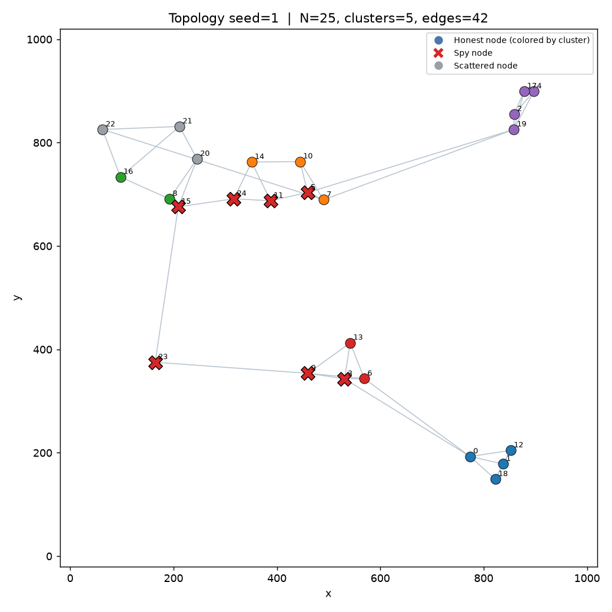
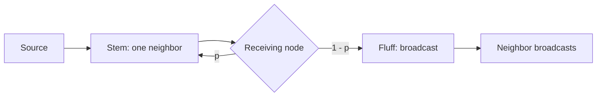
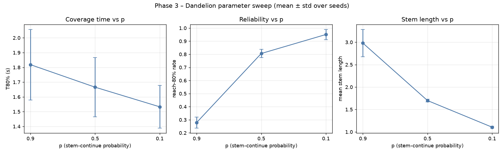
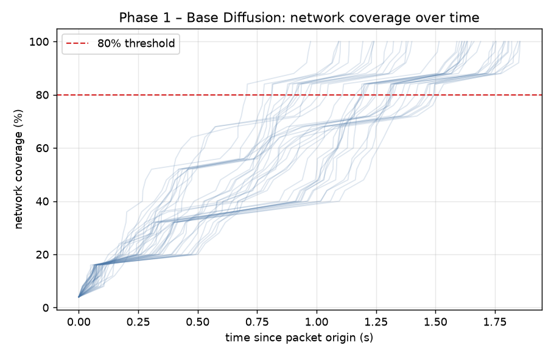
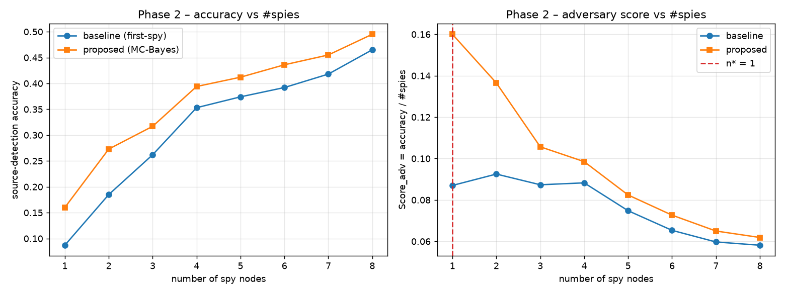
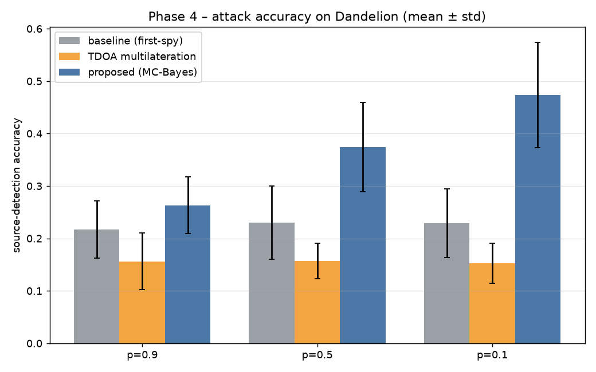
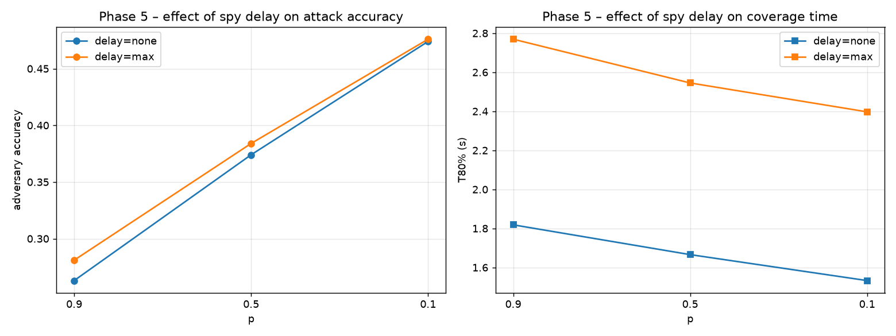

# Dandelion vs. Spy

**Exploring message propagation, source privacy, and adversarial observation in peer-to-peer networks.**


A Python network simulation project comparing ordinary diffusion with the two-stage **Stem / Fluff** Dandelion protocol. An adversary observes traffic at selected spy nodes and attempts to identify the source of each packet.

The project combines seeded discrete-event experiments with a concurrent localhost UDP runtime. It includes spatial topology generation, source-inference attacks, parameter sweeps, visualization, and a Persian project report.

[Quick start](#quick-start) · [Experiments](#experiments) · [Architecture](#architecture) · [Results](#included-results) · [Project report](Report.pdf)



## Features

- **Spatial networks:** 20–30 nodes on a 1,000 × 1,000 plane, with 4–6 dense clusters, connectivity checks, and multiple external cluster links.
- **Propagation protocols:** diffusion and Dandelion, with duplicate suppression and configurable Stem continuation probability.
- **Source inference:** betweenness-based spy placement, a first-spy baseline, time-difference-of-arrival inference, and Monte Carlo calibrated source models.
- **Timing attacks:** bounded forwarding delays at spy nodes, without deliberate packet deletion.
- **Evaluation:** source-estimation accuracy, time to reach 80% of nodes, reach rate, and privacy/performance scores.
- **Two runtimes:** logical-time simulation and real UDP traffic, sharing the same node behavior module.

## Quick start

Use **Python 3.10 or newer**. NumPy and Matplotlib are the only Python package dependencies; graph algorithms and networking use the standard library.

From the repository root:

```bash
python3 -m venv .venv
source .venv/bin/activate
python -m pip install -r Code/requirements.txt

# Generate a topology and print validation results.
python Code/main.py topology --seed 1

# Run a live UDP demonstration.
python Code/main.py demo --seed 1 --p 0.5 --packets 30
```

On Windows, activate the environment with `.venv\Scripts\Activate.ps1` in PowerShell. Use `python` instead of `python3` when that is your installed interpreter command.

The UDP runtime binds to `127.0.0.1`, using controller port **20999** and node ports starting at **21000**. Keep these ports available and run one UDP scenario at a time.

## How propagation works

In **diffusion**, the source sends to every neighbor. Each node forwards a newly seen packet to its neighbors except the previous sender. Duplicate packet IDs are ignored.

In **Dandelion**, the source starts in Stem and chooses one neighbor. Each receiving node continues along one neighbor with probability `p`, or switches to Fluff with probability `1 - p`. Fluff spreads through the network using diffusion. A Stem receiver with no eligible next neighbor also switches to Fluff.



Higher `p` tends to extend the hidden path before broadcasting. In this implementation, a Stem path can revisit a seen node and terminate before reaching Fluff; the resulting delivery loss is part of the measured tradeoff.

Network data messages carry a packet ID and state, plus a message-type discriminator. The true source and creation time remain in simulator reference data rather than the forwarded payload.

## Experiments

| Phase | Question | Function in `Code/experiments.py` |
| --- | --- | --- |
| 1 · Diffusion | How quickly does ordinary broadcast cover the network? | `experiment_phase1` |
| 2 · Diffusion attack | How does spy count affect source inference and adversary score? | `experiment_phase2` |
| 3 · Dandelion | How do `p = 0.9`, `0.5`, and `0.1` affect coverage and propagation? | `experiment_phase3` |
| 4 · Dandelion attack | How does the calibrated attack compare with the first-spy baseline? | `experiment_phase4` |
| 5 · Spy delay | How does intentional forwarding delay affect inference and coverage time? | `experiment_phase5` |

Run commands from the repository root:

```bash
# Full suite: 5 seeds, 200 packets per scenario.
python Code/main.py all

# Smaller exploratory run: 2 seeds, 60 packets per scenario.
python Code/main.py all --quick

# Run one phase with explicit seeds.
python Code/main.py phase 3 --seeds 1 2 3

# Demonstrate diffusion over real UDP.
python Code/main.py demo --phase diffusion --packets 20

# Compare aggregate metrics from both runtimes.
python Code/main.py udp-validate --seed 1 --p 0.5 --packets 40

# Inspect commands and options.
python Code/main.py --help
```

Bulk experiments use the discrete-event engine. The UDP comparison prints coverage, reach rate, T80, and baseline accuracy for both runtimes; it is a diagnostic comparison, not an automated assertion of equivalence. Host scheduling can change arrival order and measured outcomes.

Experiment runs write to `results/` and `figures/` at the repository root. Full and quick runs replace corresponding output files, including supplied figures. Regenerate quick-run results with `all` before preparing a final report.

## Evaluation and reproducibility

| Metric | Meaning |
| --- | --- |
| Accuracy | Fraction of packets whose source is guessed correctly |
| T80 | Mean time in seconds to reach 80% of nodes, over packets reaching the threshold |
| Reach rate | Fraction of packets reaching the 80% coverage threshold |
| Mean coverage | Average fraction of nodes reached by each packet |
| Adversary score | `accuracy / number_of_spies` |
| Honest-network score | `(1 - accuracy) / T80` |
| Effective honest score | `honest_score × reach_rate`, a supplementary delivery-aware metric |

**Read T80 together with reach rate.** Packets that never reach the threshold are excluded from mean T80. A favorable time or privacy score alone can therefore hide poor delivery.

Topology and scenario construction use explicit seeds. Matched comparisons reuse the topology, packet sources, and selected spy set for a given scenario. The full suite uses seeds 1–5 and reports mean, median, and standard deviation where implemented. UDP timing also depends on host scheduling.

Defaults are centralized in [Code/config.py](Code/config.py):

| Setting | Default |
| --- | --- |
| Network size | 20–30 nodes |
| Dense clusters | 4–6 |
| Preferred degree | 2–4 |
| Base link delay | 1 ms per unit of Euclidean distance |
| Link jitter | Uniform within ±20% of base delay |
| Maximum spy budget | 30% of nodes |
| Dandelion probabilities | `0.9`, `0.5`, `0.1` |
| Packets per full scenario | 200 |
| Independent seeds | 5 |
| UDP time scale | `0.2` |

## Included results

The repository includes an existing Persian [report](Report.pdf), experiment figures, and a [full-run log](logs/full_run.log). The original raw CSV files are absent from this checkout; regenerate them with `python Code/main.py all`.

The following rounded values come from the supplied log's Phase 3 and Phase 4 summaries. They describe that recorded run and are not a fresh benchmark:

| Stem probability `p` | Mean T80 (s) | Reach rate | First-spy accuracy | Proposed attack accuracy |
| --- | ---: | ---: | ---: | ---: |
| 0.9 | 1.818 | 28% | 21.7% | 26.3% |
| 0.5 | 1.666 | 81% | 23.0% | 37.4% |
| 0.1 | 1.533 | 95% | 22.9% | 47.4% |

These results illustrate the privacy/delivery tradeoff: longer Stem paths reduce source-estimation accuracy in this run while also reducing reach rate. The recorded maximal-delay experiment increases T80 for all three probabilities.



<details>
<summary>More experiment figures</summary>









</details>

## Architecture

The shared [protocol.py](Code/protocol.py) module decides how nodes originate and forward packets. The discrete-event engine schedules decisions on a logical clock. The UDP runtime uses independent localhost sockets, with one thread and asyncio loop per node.

| Module | Responsibility |
| --- | --- |
| [main.py](Code/main.py) | CLI commands and live demonstrations |
| [config.py](Code/config.py) | Topology, delays, experiment defaults, ports, output paths |
| [topology.py](Code/topology.py) | Spatial graphs, validation, shortest paths, plotting |
| [protocol.py](Code/protocol.py) | Diffusion, Stem/Fluff transitions, seen sets, delay policies |
| [sim_engine.py](Code/sim_engine.py) | Discrete-event scheduling and scenario reference logs |
| [udp_runtime.py](Code/udp_runtime.py) | Concurrent UDP nodes, packet injection, event collection |
| [adversary.py](Code/adversary.py) | Spy selection and source-estimation attacks |
| [metrics.py](Code/metrics.py) | Coverage, accuracy, scores, descriptive statistics |
| [experiments.py](Code/experiments.py) | Five-phase suite, sweeps, CSV export, figures |
| [make_report.py](Code/make_report.py) | Persian Markdown report generation from CSV files |
| [make_pdf.py](Code/make_pdf.py) | Styled HTML and browser-based PDF export |

```text
.
├── README.md
├── Code/                  # Python source and dependencies
├── Report.pdf             # Existing Persian report
├── figures/               # Supplied experiment plots
├── logs/
│   └── full_run.log        # Recorded experiment output
└── results/               # CSV outputs generated by experiment runs
```

## Generate the report

After running the full experiment suite:

```bash
python Code/make_report.py
python Code/make_pdf.py
```

The scripts generate `Report.md`, `Report.html`, and `Report.pdf` at the repository root, replacing corresponding existing report files. PDF export requires Chrome, Chromium, or Edge. If detection fails, the script produces HTML that you can print to PDF manually.

On macOS, supply the Chrome executable explicitly:

```bash
EDGE_PATH="/Applications/Google Chrome.app/Contents/MacOS/Google Chrome" python Code/make_pdf.py
```

## Scope and limitations

An educational implementation of the **Computer Networks course project (40443), Sharif University of Technology**, titled *قاصدک در برابر جاسوس: شبیه‌سازی پویا و چالش حریم خصوصی در شبکه*.

The model assumes localhost UDP delivery and does not simulate packet loss or retransmission. Spy observations are restricted to traffic reaching selected nodes, while source inference uses the generated topology and link-delay model. The runtime uses threads within one process rather than separate operating-system processes per node. These assumptions matter when interpreting results or comparing the implementation with the assignment specification.

This project studies a simplified Stem/Fluff protocol; it is not a production anonymity system or a complete implementation of Dandelion++.
